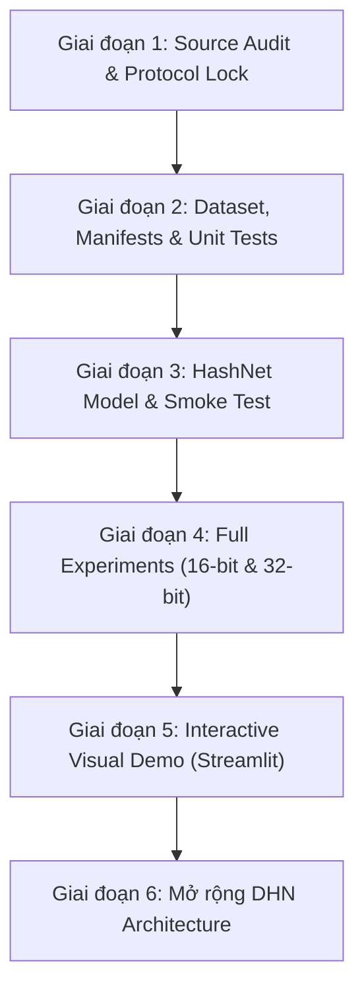

# Deep Hashing Reproduction Benchmark: HashNet & DHN on CIFAR-10

Dự án nghiên cứu tái lập có kiểm soát (controlled reproduction) một phần kết quả thực nghiệm trong bài báo:
> **“A Decade Survey of Content Based Image Retrieval using Deep Learning”**  
> Shiv Ram Dubey, *IEEE Transactions on Circuits and Systems for Video Technology (TCSVT)*, Vol. 32, No. 5, pp. 2687–2704, 2022.  
> DOI: [10.1109/TCSVT.2021.3080920](https://doi.org/10.1109/TCSVT.2021.3080920) | arXiv: [2012.00641](https://arxiv.org/abs/2012.00641).

---

## 1. Mục tiêu và Số liệu tham chiếu (Table IV)

Tập trung vào kiểm toán nguồn gốc học thuật và tái lập có kiểm soát các phương pháp Deep Hashing trên tập dữ liệu **CIFAR-10**:
- **HashNet** (*Cao et al., ICCV 2017*, ref [71]): 16 bits = **64.3%**, 32 bits = **66.7%** (mAP@54000).
- **DHN** (*Zhu et al., AAAI 2016*, ref [67]): 16 bits = **56.8%**, 32 bits = **60.3%** (mAP@54000).

> **Lưu ý**: Các con số trên là **kết quả tham chiếu (reference numbers)** được trích dẫn trực tiếp từ Reference [84] (*Jiehao Xu et al., "DHA: Supervised Deep Learning to Hash with an Adaptive Loss Function", IEEE/CVF ICCVW 2019*), **không phải** là số liệu tự nhận đã tái lập khi chưa chạy thực nghiệm.

---

## 2. Lộ trình thực hiện 6 Giai đoạn (Phases Overview)

Dự án được phân rã và triển khai nghiêm ngặt theo 6 giai đoạn kỹ thuật:



### Chi tiết từng giai đoạn:

- **Giai đoạn 1 (Phase 1): Source Audit + Khóa Protocol + Kế hoạch Implementation**
  - Đọc và thẩm định chéo Survey Dubey (Table IV), paper gốc HashNet (ICCV 2017), DHN (AAAI 2016), và paper DHA (ICCVW 2019, ref [84]).
  - Phân loại rõ ràng 2 chế độ độc lập: `survey_source` (54k DB) và `original_paper` (59k DB).
  - Hoàn thành các tài liệu: [`docs/source_audit.md`](docs/source_audit.md), [`docs/protocol.md`](docs/protocol.md), [`docs/deviations.md`](docs/deviations.md).
- **Giai đoạn 2 (Phase 2): Dataset Manifests + Metric Evaluator + Project Skeleton**
  - Xử lý dataset cục bộ tại thư mục `cifar-10/` (50,000 ảnh có nhãn xác nhận, 5,000 ảnh/lớp).
  - Sinh manifest cố định, không tạo split mới mỗi lần chạy: `outputs/splits/manifest_cifar10_survey_source.json` kèm mã băm SHA-256 (`67d9c84586abf791...`).
  - Viết `ReferenceEvaluator` (naive kiểm chứng) và `ChunkedEvaluator` (chunk-based an toàn bộ nhớ OOM).
  - Viết unit tests cho metric AP, Hamming ties, zero-relevant queries, split non-overlap.
- **Giai đoạn 3 (Phase 3): HashNet Architecture & Smoke Test**
  - Triển khai backbone AlexNet (ImageNet pretrained weights) + Hash Head $4096 \to K$ bits.
  - Cài đặt `HashNetLoss` (Weighted Maximum Likelihood Loss giải quyết similarity imbalance) và `ContinuationScheduler` $\alpha_t = \sqrt{1 + \gamma \cdot t}$.
  - Chạy smoke test end-to-end (forward/backward, finite loss, binarization strictly $\{-1, +1\}$, checkpoint save/load).
- **Giai đoạn 4 (Phase 4): HashNet 16/32-bit Full Experiments + Reference Comparison**
  - Huấn luyện đầy đủ 16-bit và 32-bit HashNet.
  - Trích xuất binary codes và đánh giá mAP@K trên toàn bộ retrieval database.
  - Xuất các file báo cáo: `results.csv`, `per_query_metrics.csv`, `training_logs.csv`, `run_metadata.json`.
  - Đối chiếu số liệu Reference vs Reproduced.
- **Giai đoạn 5 (Phase 5): Demo Trực quan hóa (Streamlit)**
  - Tab 1: Retrieval (Query $\to$ Top-10 kết quả kèm viền xanh/đỏ relevance).
  - Tab 2: Hash explanation (Ảnh query $\to$ CNN $\to$ continuous logits $\to$ binary bits $\to$ khoảng cách Hamming).
  - Tab 3: Reproduction results (Bảng so sánh reference vs reproduced, chênh lệch % điểm, đồ thị loss & mAP).
  - Tab 4: Failure cases (Phân tích truy vấn thành công vs thất bại, seed ngẫu nhiên).
- **Giai đoạn 6 (Phase 6): Mở rộng DHN (Deep Hashing Network)**
  - Tái lập mô hình DHN (AAAI 2016) với Pairwise cross-entropy similarity loss + Quantization loss.

---

## 3. Cấu trúc thư mục dự án

```text
├── configs/                          # Cấu hình thực nghiệm YAML (16-bit, 32-bit)
│   ├── hashnet_16bit.yaml
│   └── hashnet_32bit.yaml
├── docs/                             # Tài liệu học thuật và phân tích kiểm toán
│   ├── source_audit.md               # Kiểm toán nguồn gốc paper & Table IV
│   ├── protocol.md                   # Khóa protocol thực nghiệm, splits & metric
│   └── deviations.md                 # Ghi nhận các sai khác kỹ thuật & compatibility
├── src/                              # Mã nguồn lõi (Modular Source Code)
│   ├── datasets/                     # Dataset loader & manifest manager
│   │   └── cifar10_handler.py
│   ├── models/                       # Kiến trúc AlexNet & HashNet / DHN
│   │   └── hashnet.py
│   ├── losses/                       # HashNet weighted loss & continuation scheduler
│   │   └── hashnet_loss.py
│   ├── retrieval/                    # Hamming ranking & distance calculation
│   └── evaluation/                   # Evaluator tính mAP (Reference & Chunked)
│       └── metrics.py
├── scripts/                          # Kịch bản thực thi chính
│   ├── prepare_data.py               # Chuẩn bị dữ liệu và khóa manifest SHA-256
│   ├── train.py                      # Huấn luyện mô hình Deep Hashing
│   ├── extract_codes.py              # Trích xuất binary hash codes
│   └── evaluate.py                   # Đánh giá mAP từ binary codes
├── tests/                            # Bộ kiểm thử Pytest tự động
│   ├── test_metrics.py               # Unit tests metric AP, Hamming ties
│   ├── test_splits.py                # Unit tests phân chia split & manifest hash
│   └── test_smoke_hashnet.py         # Smoke test end-to-end cho mô hình HashNet
├── app/                              # Demo trực quan Streamlit Dashboard
│   └── streamlit_app.py
├── outputs/                          # Kết quả đầu ra
│   └── splits/                       # Lưu trữ manifest JSON cố định
├── requirements.txt                  # Danh sách thư viện phụ thuộc
├── .gitignore                        # Loại trừ dataset nặng & checkpoints
└── README.md
```

---

## 4. Hướng dẫn cài đặt môi trường

Dự án yêu cầu **Python 3.10+** và **PyTorch hỗ trợ CUDA 12.1**:

```bash
# 1. Tạo môi trường ảo
python3 -m venv --system-site-packages .venv

# 2. Cài đặt PyTorch với CUDA 12.1 chính thức
.venv/bin/pip install torch torchvision --index-url https://download.pytorch.org/whl/cu121

# 3. Cài đặt các thư viện cần thiết
.venv/bin/pip install -r requirements.txt
```

---

## 5. Hướng dẫn chạy từng bước (Execution Guide)

### Bước 1: Chạy kiểm thử toàn bộ hệ thống (Unit & Smoke Tests)
```bash
PYTHONPATH=. .venv/bin/python -m pytest tests/ -v
```
*(Hiện tại 11/11 tests đã vượt qua thành công bao gồm các bài kiểm tra metric, ranking, splits, và smoke test forward/backward).*

### Bước 2: Khóa dữ liệu và sinh Manifest SHA-256
```bash
.venv/bin/python scripts/prepare_data.py --data-dir cifar-10 --mode survey_source --seed 2021
```
- Query: 1,000 ảnh (100 ảnh/lớp).
- Train: 5,000 ảnh (500 ảnh/lớp).
- Retrieval Database: 44,000 ảnh (4,400 ảnh/lớp).
- Không chồng chéo: $Q \cap T = \emptyset, Q \cap D = \emptyset, T \cap D = \emptyset$.

### Bước 3: Huấn luyện HashNet (16-bit / 32-bit)
```bash
# Huấn luyện HashNet 16-bit
.venv/bin/python scripts/train.py --config configs/hashnet_16bit.yaml

# Huấn luyện HashNet 32-bit
.venv/bin/python scripts/train.py --config configs/hashnet_32bit.yaml
```

### Bước 4: Trích xuất Binary Codes & Đánh giá mAP
```bash
# Đánh giá 16-bit
.venv/bin/python scripts/evaluate.py \
  --config configs/hashnet_16bit.yaml \
  --checkpoint outputs/experiments/hashnet_16bit/checkpoint_final.pth

# Đánh giá 32-bit
.venv/bin/python scripts/evaluate.py \
  --config configs/hashnet_32bit.yaml \
  --checkpoint outputs/experiments/hashnet_32bit/checkpoint_final.pth
```

### Bước 5: Khởi chạy Giao diện Trực quan hóa (Streamlit Demo)
```bash
.venv/bin/streamlit run app/streamlit_app.py
```

---

## 6. Minh bạch về Sai lệch Kỹ thuật (Deviations Log)

Mọi sai khác so với bài báo gốc đều được ghi chép minh bạch tại [`docs/deviations.md`](docs/deviations.md):
1. **Framework**: Nâng cấp từ Caffe / PyTorch 0.3.1 sang PyTorch 2.5.1 (CUDA 12.1).
2. **Kích thước Database**: CIFAR-10 có nhãn cục bộ gồm 50,000 ảnh (1k Query, 5k Train, 44k Database). Kết quả được phân loại là *modified reimplementation (mAP@44000)* thay vì *exact reproduction 54k*.
3. **Phần cứng**: Hỗ trợ linh hoạt tự động chuyển đổi giữa GPU NVIDIA RTX 3050 (CUDA 12.1) và đa luồng CPU.
